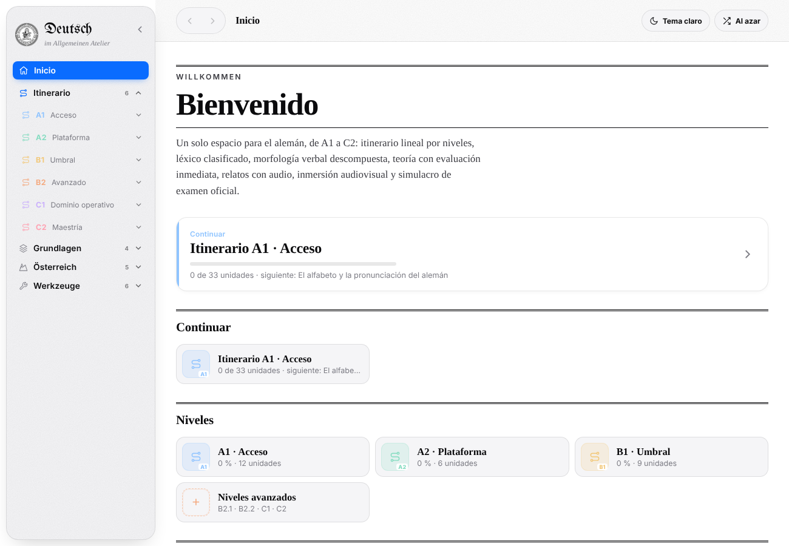

# Deutsch · Atelier

Aula interactiva y gratuita de **alemán, inglés, francés y español** (A1 – C2). Tres botones flotantes en la esquina:
el **gorro** cambia de enfoque, el **cerebro** cambia la lengua de estudio y el **bombillo** ofrece ayuda:

- **Práctica** — para comunicarse, leer, escribir y entender: itinerario por niveles con horas y requisitos,
  unidades de gramática con cuestionario (59 de alemán, 36 por cada una de las otras lenguas), conjugador,
  **lectura crítica** de obras de dominio público (una por nivel), **traducción sistemática**, recursos y
  noticieros oficiales, **«¿Sabías que…?»** cultural, **libros y consejos**, prueba de nivel y **Mi progreso**.
  El alemán conserva además léxico, relatos con audio, simulacros y las secciones de Austria y Suiza.
- **Lingüística** — para políglotas, lingüistas y filósofos del lenguaje: fonética, fonología, morfología,
  sintaxis, tiempo-aspecto-modo, léxico, semántica, ortografía y dialectología/sociolingüística, en tres niveles de
  progresión, con herramientas (árbol sintáctico, inventario AFI, segmentador, concordancias, léxico
  comparado) y una biblioteca de acceso abierto.

Cada nivel es un **curso** con página de presentación y ficha técnica (requisitos, dedicación, temario,
criterios del examen oficial e hitos de aprobado).

Comunes: gramática contrastiva ES·DE·EN·FR, botón **«El Bombillo»** con estrategias basadas en la ciencia
cognitiva, idioma de la interfaz (español, Deutsch, English, Français) en el panel «Aa», tipografía de rótulo
propia de cada lengua (Fraktur, IM Fell English, Garamond, Ibarra Real Nova) y cuenta de Google opcional.

Se distribuye de dos formas, ambas generadas desde este repositorio:

| Salida | Archivo | Uso |
|---|---|---|
| Página autónoma | `dist/deutsch-atelier.html` | Abrir en cualquier navegador o alojar en una web |
| Paquete SCORM 1.2 | `dist/deutsch-atelier-scorm12.zip` | Subir a Moodle como actividad «Paquete SCORM» |



## Estructura

```
deutsch-atelier/
├── index.html              Punto de entrada de desarrollo (enlaza css/, data/, js/, modules/)
├── css/
│   ├── fonts.css           @font-face de las tipografías locales
│   ├── base.css            Componentes, vistas y tokens base
│   ├── theme.css           Capa visual: acrílico, Liquid Glass, tipografía de periódico, Österreich
│   ├── lectura.css         Modo lectura (fondos de papel, letra, interlineado, márgenes)
│   ├── curso.css           Páginas de curso, acabado acrílico con bisel
│   └── idiomas.css         Interruptor de lengua, conjugador, contrastiva, pie de recursos, aviso de cookies
├── data/                   Contenido puro, sin lógica (se carga antes que js/app.js)
│   ├── verbos.js           Repertorio verbal
│   ├── irregulares.js      170 verbos irregulares (Stammformen)
│   ├── lexico.js           Léxico, ejemplos y vocabulario nuclear
│   ├── gramatica.js        59 unidades de gramática y cuestionarios
│   ├── relatos.js          Geschichten por nivel
│   ├── sintaxis.js         Satzbau
│   ├── examenes.js         Simulacros
│   ├── curriculo.js        Itinerario por nivel
│   ├── en.js               Inglés: 36 unidades, recursos oficiales, horas por nivel
│   ├── fr.js               Francés: 36 unidades, recursos oficiales, horas por nivel
│   ├── es.js               Español (ELE): 36 unidades, recursos oficiales, horas por nivel
│   ├── tiempos.js          Horas y requisitos de cada unidad de alemán; horas por nivel (Goethe)
│   ├── contraste.js        Fichas contrastivas ES·DE·EN·FR y falsos amigos
│   ├── lecturas.js         Lectura crítica (24 textos de dominio público) y traducción sistemática
│   ├── linguistica.js      Sección lingüística: 8 ámbitos × 4 lenguas, biblioteca abierta, léxico comparado
│   ├── paises.js           Vocabulario y rasgos de cada país («¿Sabías que…?»)
│   ├── lingcurso.js        Plan de estudios lingüístico: 8 cursos × 3 módulos
│   └── cultura.js          «¿Sabías que…?», países, variedades, noticieros; libros y consejos
├── js/
│   ├── app.js              Núcleo: navegación, vistas y prácticas
│   ├── performance.js      Optimizaciones (cálculo de palabras parecidas, desplazamiento)
│   └── scorm.js            Puente SCORM 1.2 con el LMS
├── modules/
│   ├── oesterreich.js      Sección Österreich (datos + vista)
│   ├── schweiz.js          Sección Schweiz (datos + vista)
│   ├── bibliografia.js     Grammatikbücher: bibliografía, capítulos equivalentes y «Para profundizar»
│   ├── stammformen.js      Tabla de verbos irregulares (Werkzeuge)
│   ├── legal.js            Pie de página: aviso legal, derechos de autor, privacidad y cookies
│   ├── cuenta.js           Progreso local, exportar / importar y cuenta de Google (Firebase, opcional)
│   ├── conjugador.js       Conjugador DE / EN / FR / ES (motores propios) con entrenamiento
│   ├── curso.js            Catálogo de cursos y ficha técnica de cada nivel (4 lenguas)
│   ├── practica.js         Lectura crítica, traducción, cultura, libros y consejos, Mi progreso
│   ├── linguistica.js      Enfoque analítico: ámbitos, herramientas y biblioteca abierta
│   ├── idiomas.js          Interruptores de lengua y de enfoque, vistas EN/FR/ES, contrastiva, tiempos, pie de recursos
│   ├── anuncios.js         Google AdSense con consentimiento previo (solo web; excluido del SCORM)
│   ├── lectura.js          Panel de lectura tipo Kindle («Aa» en la barra superior)
│   ├── interfaz.js         Idioma de la interfaz (ES · DE · EN · FR), dentro del panel «Aa»
│   └── bombillo.js         «El Bombillo»: ayuda rápida con estrategias basadas en la investigación
├── media/
│   ├── fonts/              Inter, Tinos, UnifrakturMaguntia (licencia OFL)
│   └── images/             Sello, favicon
├── scorm/
│   └── imsmanifest.xml     Manifiesto SCORM 1.2
├── tools/
│   ├── build.py            Compila dist/ (HTML único + zip SCORM)
│   └── check_links.py      Verifica los enlaces externos
├── ads.txt.example         Plantilla de ads.txt para AdSense
├── docs/                   Documentación técnica y capturas
└── dist/                   Salidas compiladas (no se versiona; ver Releases)
```

## Desarrollo

Requisitos: **Python 3.8+**. Opcional: **Node.js** (para comprobar la sintaxis JS).

```bash
# servir en local (las fuentes no cargan con file:// en algunos navegadores)
python -m http.server 8000
# abrir http://localhost:8000/

# compilar (minifica si encuentra terser: npm install --prefix tools)
python tools/build.py --check

# comprobar enlaces externos
python tools/check_links.py
```

Orden de carga de los scripts (importa): `data/*.js` → `js/app.js` → `js/performance.js` →
`modules/oesterreich.js` → `modules/schweiz.js` → `modules/bibliografia.js` → `modules/stammformen.js` → `modules/legal.js` →
`modules/cuenta.js` → `modules/conjugador.js` → `modules/practica.js` → `modules/curso.js` → `modules/linguistica.js` → `modules/idiomas.js` →
`modules/anuncios.js` → `modules/lectura.js` → `modules/interfaz.js` → `modules/bombillo.js` → `js/scorm.js`.
Todos son scripts clásicos que comparten el ámbito global.

## Navegación
Las flechas **‹ ›** de la barra superior son el único control de retroceso: recuerdan página, nivel, tema o
relato abierto, lengua y posición de desplazamiento. También responden a **Alt + ← / →**, a los botones
laterales del ratón y, en pantallas táctiles, a un deslizamiento desde el borde.

## Cuenta de Google
El progreso se guarda siempre en el navegador. Para sincronizarlo con una cuenta de Google, rellene `FIREBASE`
en `modules/cuenta.js` con la configuración web de un proyecto propio de Firebase (Authentication con proveedor
Google + Cloud Firestore); las instrucciones y las reglas de seguridad están en la cabecera del archivo.

## Publicidad y derechos
Ver [docs/derechos-y-anuncios.md](docs/derechos-y-anuncios.md): qué se puede publicar, cómo activar
Google AdSense con consentimiento y qué falta rellenar antes de hacerlo.

## Moodle

Ver [docs/scorm-moodle.md](docs/scorm-moodle.md). Resumen: *Añadir actividad › Paquete SCORM*,
subir `deutsch-atelier-scorm12.zip`, mostrar en la página actual o en ventana nueva, y usar
«completado» como criterio de finalización (el paquete no envía calificación).

## Documentación

- [docs/arquitectura.md](docs/arquitectura.md) — cómo está organizado el código y cómo ampliarlo
- [docs/enlaces.md](docs/enlaces.md) — enlaces externos verificados y su estado
- [docs/contraste.md](docs/contraste.md) — contraste con gramáticas de referencia y cambios derivados
- [docs/scorm-moodle.md](docs/scorm-moodle.md) — publicación en Moodle y seguimiento
- [CHANGELOG.md](CHANGELOG.md)

## Autoría y derechos

© 2026 Juan Fernando Martínez Cristancho. Todos los derechos reservados.

Proyecto personal e independiente, no vinculado a ninguna institución. Su uso para aprender o enseñar es
libre y gratuito; la reproducción, redistribución o adaptación del contenido o del código requiere
autorización del titular. Los textos completos están en el pie de la página (Aviso legal, Derechos de autor,
Privacidad y cookies) y se editan en `modules/legal.js` (objeto `LEGAL`: titular, país, contacto, repositorio).

Tipografías de terceros bajo SIL Open Font License: Inter, Tinos, UnifrakturMaguntia.
Los recursos externos enlazados (DW, ORF, SRF, Sprachportal, Österreich Institut, fide, grammis, etc.) pertenecen a sus autores.
